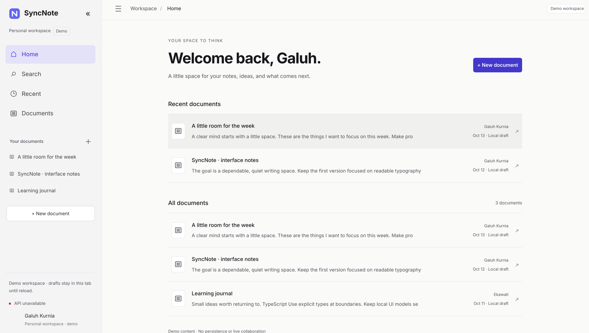

# SyncNote


SyncNote is an open-source-oriented, real-time collaborative note-taking application currently in its foundation milestone.



The project aims to provide a modern workspace for creating, organizing, and collaboratively editing notes. At this stage, SyncNote includes a Next.js frontend workspace and a lightweight Go REST API. Persistent document storage and real-time collaboration are planned for future development.

## Technology Stack

| Layer | Technology |
|---|---|
| Frontend | Next.js App Router, React, TypeScript |
| Styling | Tailwind CSS |
| Backend | Go (`net/http`) |
| Current API | `GET /api/v1/health` |
| Architecture | Separate frontend and backend services |

## Repository Structure

```text
SyncNote/
├── frontend/       # Next.js application
├── backend/        # Go REST API service
├── docs/           # Product, architecture, API, design, and security documentation
└── README.md       # Project overview
```

## Prerequisites

Ensure the following tools are installed:

- Node.js 20.9 or later
- npm
- Go 1.27.1 or later

## Getting Started

**1. Configure the environment**

Copy `frontend/.env.example` to `frontend/.env.local` if you need to customize the backend URL.

Default backend URL:

```env
http://localhost:8080
```

**2. Start the backend**

```bash
cd backend
go run ./cmd/server
```

**3. Start the frontend**

Open another terminal:

```bash
cd frontend
npm install
npm run dev
```

**4. Access the application**

| Service | URL |
|---|---|
| Frontend | http://localhost:3000 |
| Backend | http://localhost:8080 |
| Backend Health API | http://localhost:8080/api/v1/health |
| Proxied Health API | http://localhost:3000/api/v1/health |

## Development Checks

**Frontend**

```bash
cd frontend
npm run lint
npm run build
```

**Backend**

```bash
cd backend
gofmt -l ./cmd/server/main.go
go vet ./...
go test ./...
```

## Project Status

**Current milestone: Foundation Development**

The application currently provides:

- A Next.js notes workspace.
- Temporary in-memory sample notes.
- Editable text fields.
- Static collaborator examples.
- Browser-visible backend health status.
- A lightweight Go REST health endpoint.

The following capabilities are planned but not yet implemented:

- User authentication and authorization.
- Persistent note and document storage.
- Document management REST APIs.
- PostgreSQL database integration.
- Redis integration.
- Real-time synchronization using WebSockets.
- Collaborative presence indicators.
- Conflict-safe concurrent editing.

The current workspace is intended for initial development and interface exploration. Notes are not persisted, and collaborative editing is not yet functional.

See [Architecture Documentation](docs/ARCHITECTURE.md) for additional information about the system design and implementation boundaries.

## Open Source & Contributions

SyncNote is being developed with the intention of becoming an open-source project.

Community contributions, issue reports, technical discussions, and improvement proposals are welcome.

See [the contribution guidelines](.github/CONTRIBUTING.md) for setup, development checks, and the Pull Request workflow. Licensing information will be published as part of the project's open-source preparation.

## Main Developer

**galhkoernia**

Software Engineering · Web Development

GitHub: [@galhkoernia](https://github.com/galhkoernia)

---

Developed and maintained by **galhkoernia**.